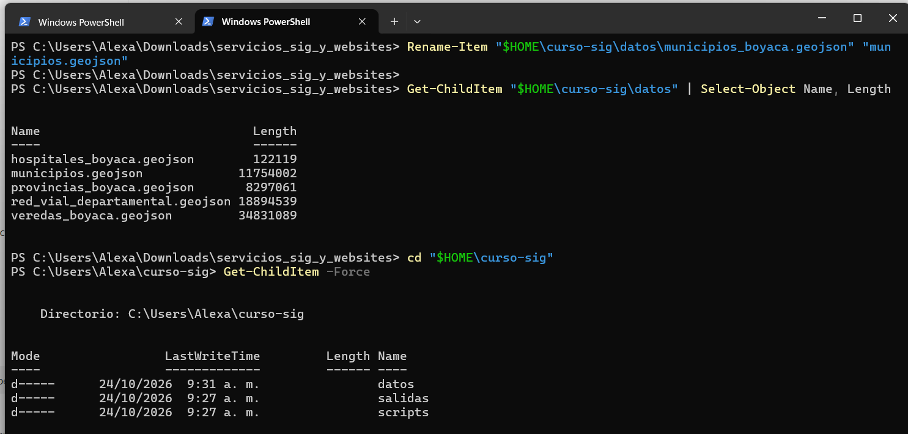
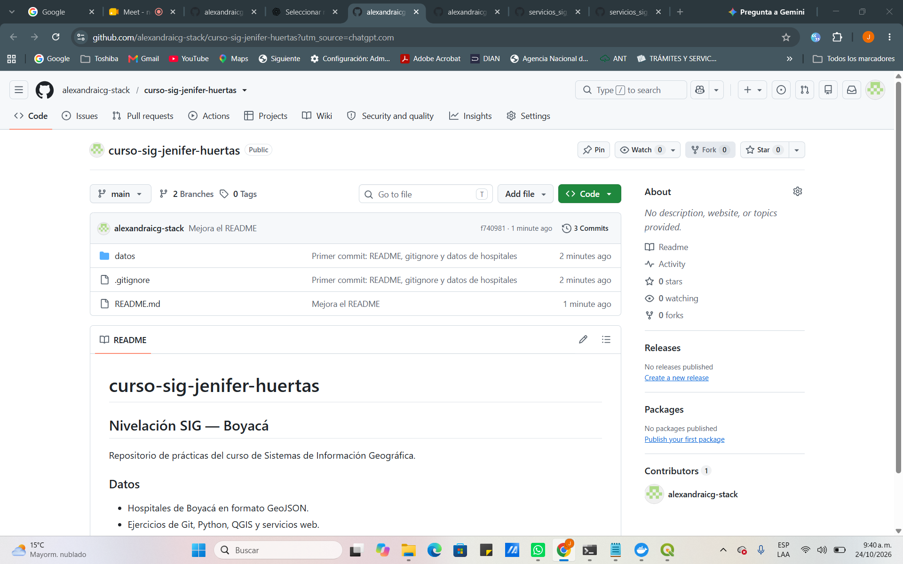
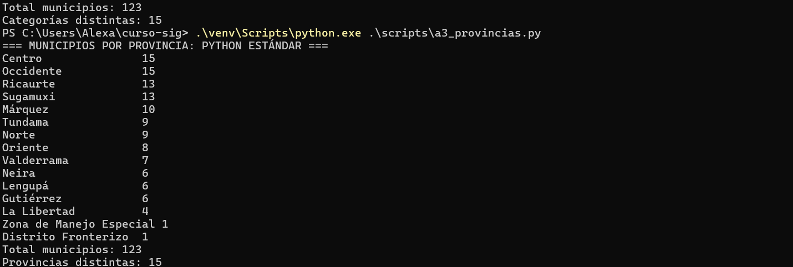
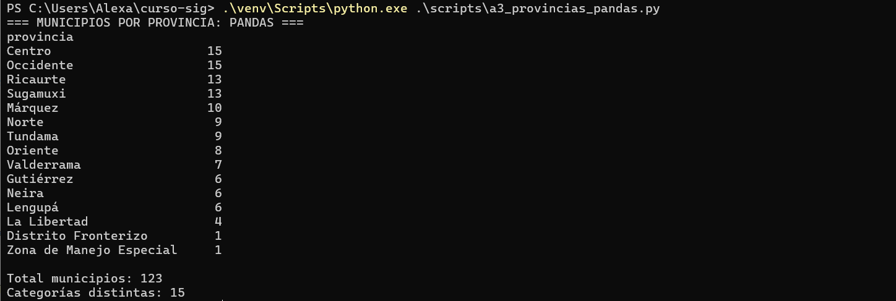
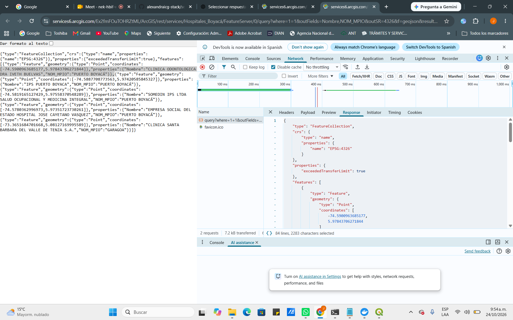
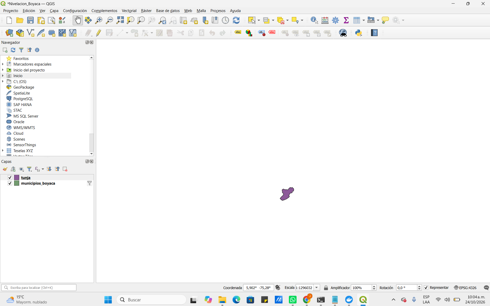
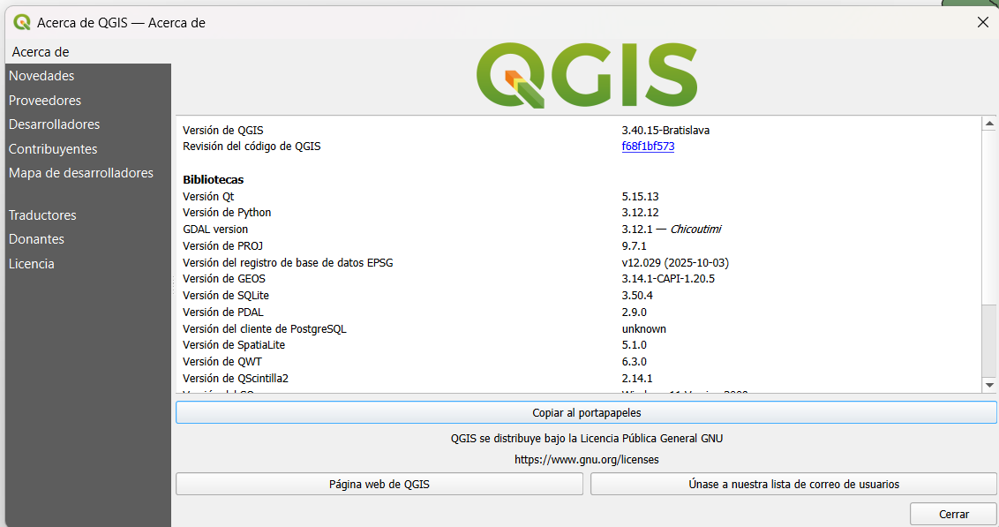

# Ruta A — Nivelación SIG | Boyacá

**Autora:** Jenifer Alexandra Huertas López  
**Elaboración y entrega:** Noviembre de 2026  
**Ámbito de estudio:** Boyacá, Colombia

## Presentación

La Ruta A reúne cinco actividades de fundamentación en terminal, Git, Python, servicios web y QGIS. Esta documentación incorpora evidencias gráficas recuperadas del informe de entrega original. Las fechas visibles en las capturas y el PDF fuente corresponden a las pruebas documentadas.

## A1. Archivos y terminal

Se organizó el entorno de trabajo con carpetas para datos, scripts y salidas. En la sesión documentada se descargaron **123 municipios**, **1.713 veredas**, **464 hospitales**, **614 registros viales** y **123 entidades clasificadas por provincia**; se trabajó con cinco GeoJSON y se renombró el de municipios a `municipios.geojson`.

*Figura A1. Organización de archivos y datos geográficos.*

## A2. Git y GitHub

Se trabajó con un repositorio público, archivo README, `.gitignore`, rama `main` y una rama de edición `ajuste-readme`, posteriormente fusionada con la principal.

*Figura A2. Ejercicio de control de versiones.*

## A3. Python y pandas

Se verificó el conteo de **123 municipios** distribuidos en **15 valores de clasificación** del atributo provincia, correspondientes a **13 provincias y dos categorías especiales**. Los resultados de Python estándar y pandas coincidieron.

*Figura A3. Conteo inicial de municipios por provincia.*

*Figura A4. Comprobación independiente con pandas.*

## A4. Web y JSON

Se realizaron consultas web de **5 y 10 entidades**; se examinaron respuestas `FeatureCollection` con geometría `Point`, sistema de referencia **EPSG:4326** y estado HTTP **200** mediante las herramientas de desarrollo del navegador.

*Figura A5. Inspección de la respuesta GeoJSON.*

## A5. QGIS y GeoPackage

Se utilizó **QGIS 3.40.15**. Se filtró Tunja, se exportó información a GeoPackage y se conservó el proyecto en **EPSG:4326**. La verificación registrada identificó para Puerto Boyacá el valor `mpio_narea = 1513,60103672 km²`. Las áreas calculadas en otros análisis se trabajaron en **EPSG:9377**, sin confundir el valor del atributo con una medición independiente.

*Figura A6. Capa de Tunja en el proyecto QGIS.*

### Verificación del entorno

*Figura A7. Comprobación del entorno QGIS.*

## Archivos relacionados

- [Checklist del entorno](../00_checklist_entorno.md)
- [Proyecto QGIS](../datos/Nivelacion_Boyaca.qgz)
- [Datos municipales GeoJSON](../datos/municipios_boyaca.geojson)
- [Ficha de datos DANE](../datos/ficha_datos_dane.md)
- [Guías originales de la Ruta A](../GUIAS_ORIGINALES/ruta_A/)

## Resultados y conclusión

La Ruta A permitió comprobar la adquisición y organización de información geográfica, el control de versiones, el procesamiento tabular mediante dos métodos y la exploración de geometrías y atributos mediante servicios web y QGIS. Los conteos y las capturas describen las pruebas realizadas, no una validación jurídica o posicional de los datos.

**Fuente de evidencias:** *Entrega Módulo 0 — Rutas A y B — Boyacá*, páginas 1–7.  
**Documento de entrega:** Noviembre de 2026.
