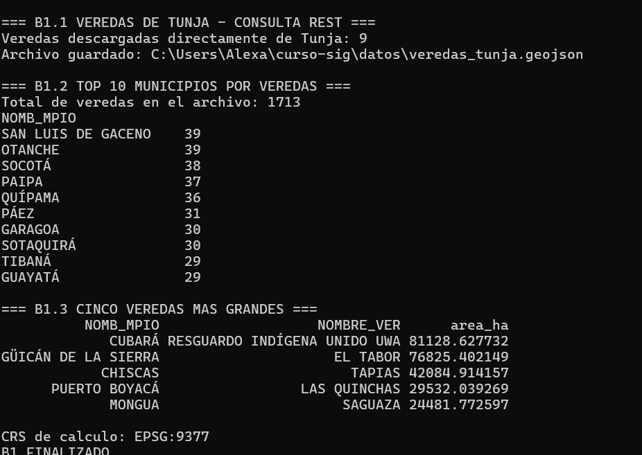
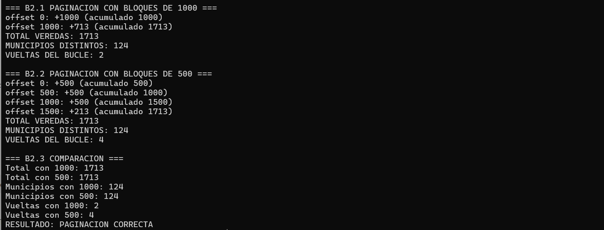
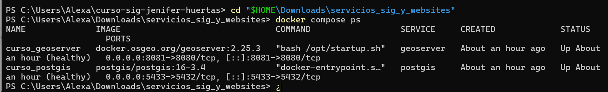
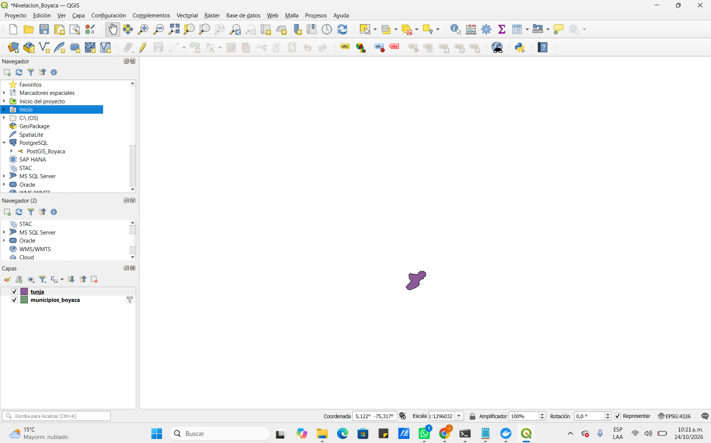
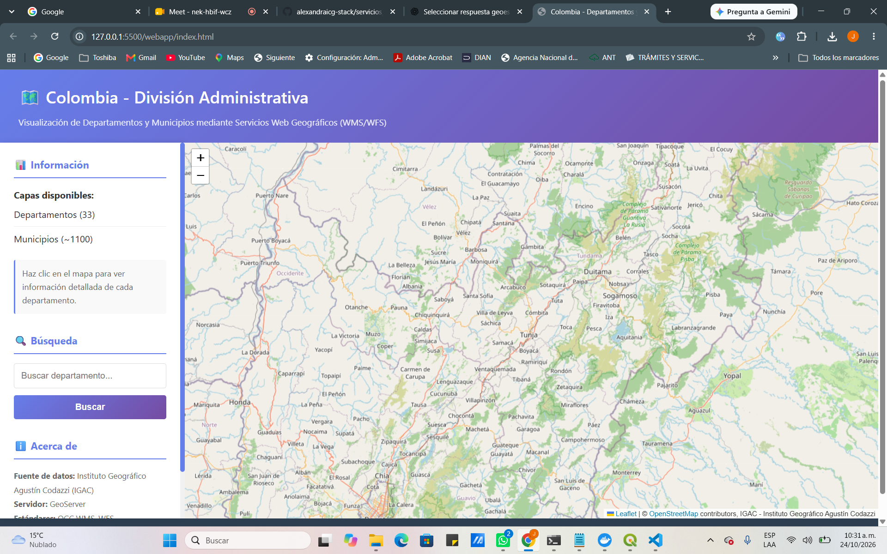

# Ruta B — Nivelación SIG | Boyacá

**Autora:** Jenifer Alexandra Huertas López  
**Elaboración y entrega:** Noviembre de 2026  
**Ámbito de estudio:** Boyacá, Colombia

## Presentación

La Ruta B reúne los ejercicios de GeoPandas, consumo de APIs, Docker/PostGIS y edición de una aplicación cartográfica web. Las figuras corresponden a evidencias reales del informe original; sus fechas de captura pueden ser anteriores a la fecha de esta entrega.

## B1. GeoPandas y análisis espacial

Se trabajó con **1.713 veredas de Boyacá**, incluyendo una consulta de **9 veredas de Tunja** por REST. Se generaron resultados de las **diez** y **cinco** áreas mayores documentadas; los cálculos de superficie se realizaron con un CRS proyectado **EPSG:9377**.

*Figura B1. Resultado del análisis espacial de veredas.*

**Script existente:** [b1_veredas.py](b1_veredas.py).

## B2. APIs y paginación

Se recuperaron **1.713 veredas** mediante dos configuraciones de paginación: páginas de **1.000** y **500** registros, con **dos** y **cuatro** solicitudes, respectivamente. Se observaron **124 valores distintos en el campo `NOMB_MPIO`**, lo que **no significa que Boyacá tenga 124 municipios oficiales**.

*Figura B2. Recuperación y verificación de registros mediante API.*

**Script existente:** [b2_paginacion.py](b2_paginacion.py).

## B3. Docker, PostGIS y QGIS

Se comprobó el funcionamiento de los servicios **PostGIS (puerto 5433)** y **GeoServer (puerto 8081)** en el entorno Docker de la nivelación. Se verificó la conexión a PostGIS desde QGIS utilizando el puerto correcto. Esta instalación no debe confundirse con otros proyectos locales que utilizan PostgreSQL en el puerto 5432.

*Figura B3. Estado de los servicios de Docker.*

*Figura B4. Verificación de la conexión desde QGIS.*

## B4. Visual Studio Code y visor local

Se ajustó la vista inicial del mapa hacia **Boyacá**, con centro `[5.55, -73.35]` y nivel de zoom **9**. El ejercicio se probó mediante Live Server y es **independiente del visor público de la Ruta C**.

*Figura B5. Resultado de la edición y ejecución local del visor.*

## Archivos relacionados

- [Script B1: GeoPandas](b1_veredas.py)
- [Script B2: paginación](b2_paginacion.py)
- [Ficha de datos DANE](../datos/ficha_datos_dane.md)
- [Guías originales de la Ruta B](../GUIAS_ORIGINALES/ruta_B/)

## Resultados y conclusión

La Ruta B permitió demostrar operaciones de análisis espacial, consulta paginada, conectividad con servicios geoespaciales locales y ajustes de una aplicación cartográfica. Los resultados citados son los de las pruebas documentadas; no se atribuyen verificaciones adicionales que no consten en las evidencias.

**Fuente de evidencias:** *Entrega Módulo 0 — Rutas A y B — Boyacá*, páginas 8–12.  
**Documento de entrega:** Noviembre de 2026.
