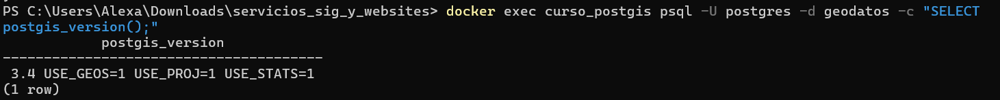
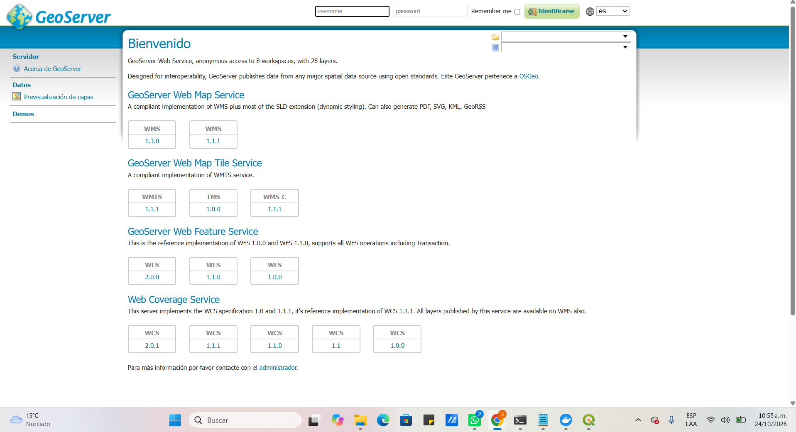
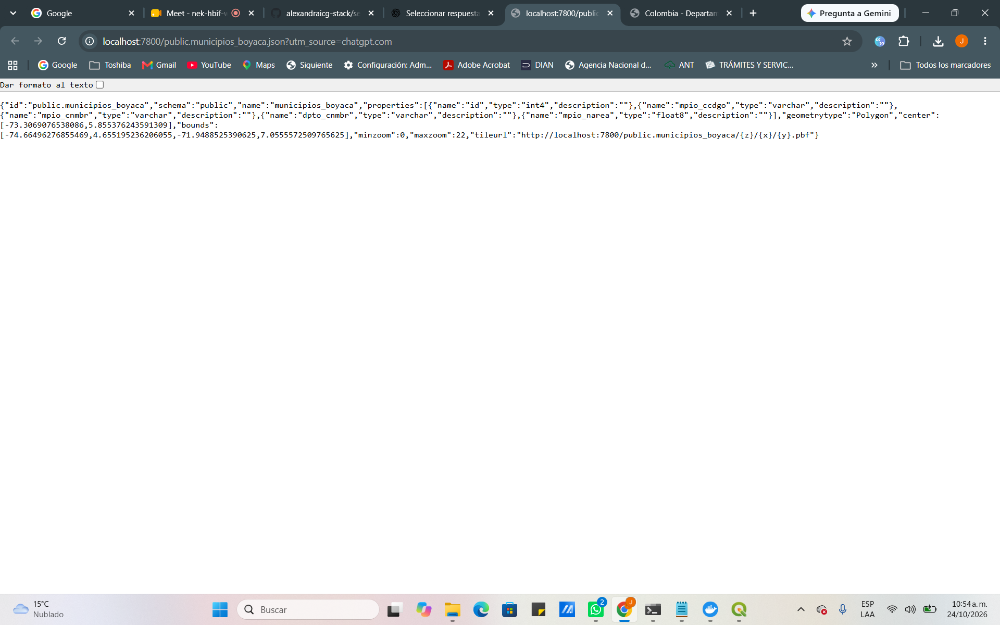
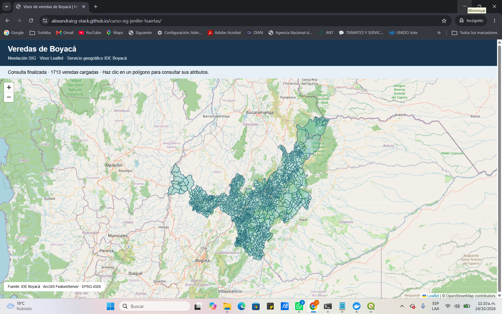

# RUTA C — NIVELACIÓN EN SISTEMAS DE INFORMACIÓN GEOGRÁFICA

**Autora:** Jenifer Alexandra Huertas López  
**Área de estudio:** Sistemas de Información Geográfica  
**Departamento de estudio:** Boyacá, Colombia  
**Fecha de entrega:** Noviembre de 2026

---

## Presentación

Esta ruta aborda la interoperabilidad de servicios geográficos, la implementación de infraestructura espacial y el desarrollo de aplicaciones cartográficas web.

Los ejercicios se desarrollaron utilizando información geográfica de Boyacá y herramientas de código abierto.

## Actividades desarrolladas

| Actividad | Tema | Resultado documentado |
|---|---|---|
| C1 | Estándares y servicios geográficos | Comparación de WMS, WFS, FeatureServer y OGC API Features |
| C2 | Infraestructura geoespacial | Integración de PostGIS, GeoServer y pg_tileserv |
| C3 | Visualización web con Leaflet | Visor de veredas de Boyacá publicado mediante GitHub Pages |

---

## C1. Comparación de servicios geográficos

Se analizaron las características de cuatro mecanismos de acceso y publicación de información geoespacial.

| Servicio | Características |
|---|---|
| WMS | Publicación de cartografía como imágenes |
| WFS | Consulta de geometrías y atributos |
| ArcGIS FeatureServer | Consultas de entidades mediante servicios REST |
| OGC API Features | Acceso a información vectorial mediante API y enlaces de navegación |

El ejercicio incluyó consultas a servicios y revisión de sus mecanismos de filtrado y paginación.

### Resultados

En las pruebas documentadas, el servicio WMS del DANE respondió correctamente a GetCapabilities. También se realizaron consultas a FeatureServer y a una implementación de OGC API Features.

---

## C2. Implementación de infraestructura espacial

Se trabajó con las siguientes herramientas:

- PostgreSQL y PostGIS 3.4.
- GeoServer.
- pg_tileserv.
- Docker.

### Resultados

Se verificó la habilitación de PostGIS y la importación de **123 municipios de Boyacá** a la tabla `public.municipios_boyaca`.

GeoServer estuvo disponible mediante el puerto local `8081`.

El catálogo de pg_tileserv reconoció la tabla de municipios y proporcionó información para acceder a teselas vectoriales.

### Alcance

Estas verificaciones comprueban conectividad, publicación y consulta de servicios. No constituyen una evaluación de precisión geométrica o validez jurídica de los datos.

---

## C3. Visor cartográfico con Leaflet

Se implementó un visor web que utiliza:

- Leaflet.
- OpenStreetMap.
- Datos vectoriales de veredas de Boyacá.
- GitHub Pages como plataforma de publicación.

### Resultados

En la prueba registrada se cargaron **1.713 geometrías de veredas**, representadas como polígonos interactivos sobre el mapa base.

**Enlace del visor documentado:**

https://alexandraicg-stack.github.io/curso-sig-jenifer-huertas/

La disponibilidad actual del enlace debe comprobarse independientemente del resultado registrado en la entrega.

---

## Fuente de información

Se utilizaron recursos de información geográfica del DANE, incluyendo información del Marco Geoestadístico Nacional 2024.

[Geoportal DANE](https://geoportal.dane.gov.co/)

El uso de estos datos está sujeto a sus condiciones de acceso y atribución.

---

---

## Conclusiones

La Ruta C permitió integrar el consumo de estándares geográficos con herramientas de almacenamiento espacial, publicación de servicios y representación web.

La implementación de PostGIS, GeoServer y pg_tileserv permitió comprobar componentes de una arquitectura de servicios geográficos.

El visor Leaflet constituye una aplicación práctica de visualización de información vectorial de Boyacá, respaldada por las evidencias de ejecución.

---

**Jenifer Alexandra Huertas López**  
**Noviembre de 2026**

---

<!-- INICIO EVIDENCIAS RUTA C -->

## Evidencias gráficas de la Ruta C

Las siguientes capturas documentan los resultados obtenidos durante el desarrollo de las actividades C2 y C3 de la nivelación SIG.

### C2.1. PostgreSQL y PostGIS — Municipios de Boyacá

Se verificó la disponibilidad de PostGIS y la incorporación de 123 municipios de Boyacá en la tabla `public.municipios_boyaca`.

*Figura 1. Verificación de PostGIS y de la información municipal de Boyacá.*

### C2.2. GeoServer — Servicios geográficos

Se comprobó el acceso a GeoServer, disponible localmente en el puerto 8081, con interfaces para la publicación y consulta de servicios geográficos.

*Figura 2. Acceso al servidor GeoServer y sus servicios.*

### C2.3. pg_tileserv — Catálogo de teselas vectoriales

Se verificó el reconocimiento de `public.municipios_boyaca` en el catálogo de pg_tileserv y la disponibilidad de su referencia para solicitar teselas vectoriales.

*Figura 3. Consulta del catálogo de capas vectoriales mediante pg_tileserv.*

### C3. Visor cartográfico Leaflet — Veredas de Boyacá

Se desarrolló y probó un visor web con Leaflet y OpenStreetMap. Durante la prueba documentada se visualizaron 1.713 geometrías correspondientes a veredas de Boyacá.

*Figura 4. Visor web Leaflet con la información de veredas de Boyacá.*

**Visor documentado:** https://alexandraicg-stack.github.io/curso-sig-jenifer-huertas/

<!-- FIN EVIDENCIAS RUTA C -->