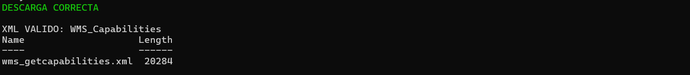
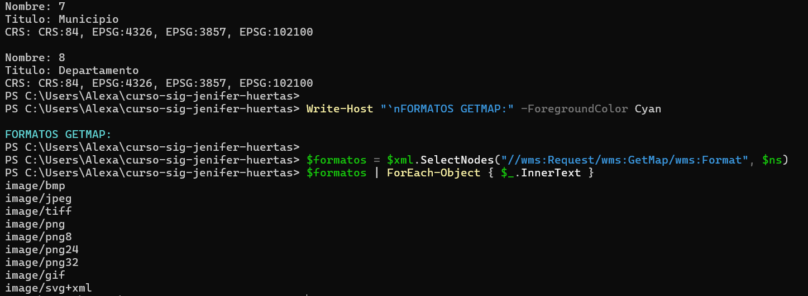
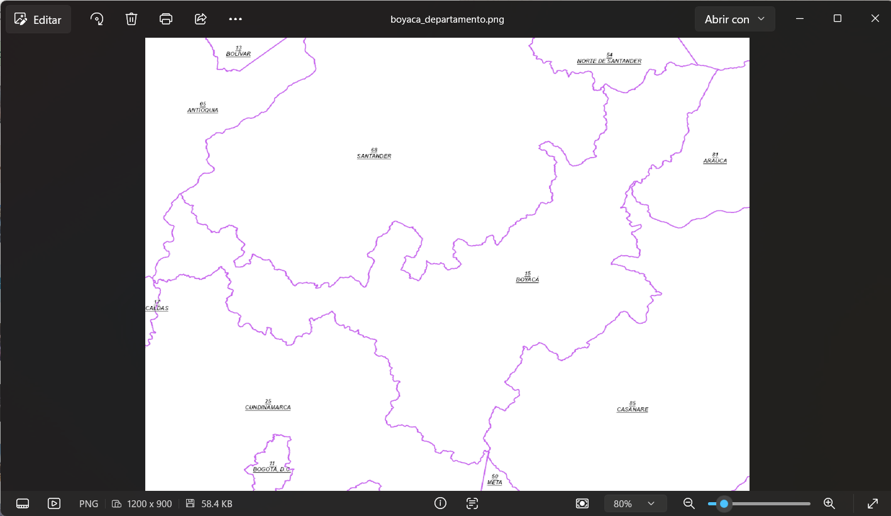
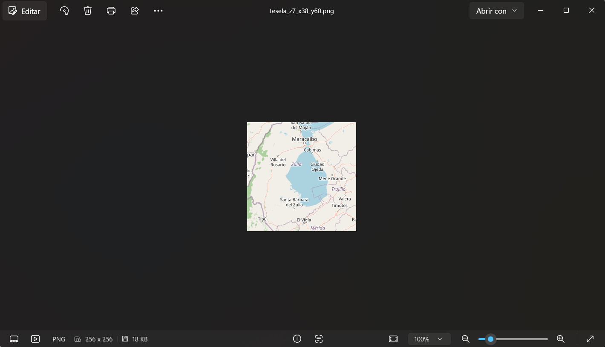
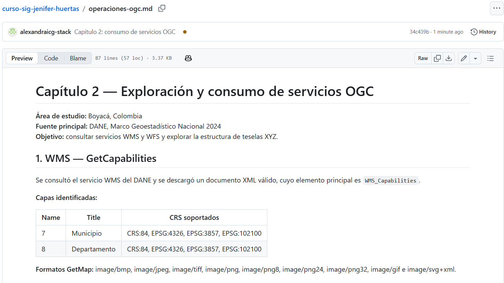

# Capítulo 2 — Exploración y consumo de servicios OGC

**Curso:** Servicios SIG y aplicaciones web geográficas  
**Guía:** `taller/capitulo-02-consumir-servicios-ogc.md`  
**Área de estudio:** zona de Boyacá, Colombia  
**Fuente principal:** DANE, Marco Geoestadístico Nacional 2024

## 1. Objetivo

Consumir servicios geográficos públicos para identificar operaciones WMS y WFS, extraer imágenes y entidades vectoriales, y comprender el esquema de teselas XYZ.

## 2. WMS — GetCapabilities

Se consultó el servicio WMS del DANE. La respuesta se descargó correctamente como XML, con nodo raíz `WMS_Capabilities` y un tamaño observado de **20.284 bytes**.

| Nombre de capa | Título | CRS disponibles |
|---|---|---|
| `7` | Municipio | `CRS:84`, `EPSG:4326`, `EPSG:3857`, `EPSG:102100` |
| `8` | Departamento | `CRS:84`, `EPSG:4326`, `EPSG:3857`, `EPSG:102100` |

**Formatos GetMap observados:** `image/bmp`, `image/jpeg`, `image/tiff`, `image/png`, `image/png8`, `image/png24`, `image/png32`, `image/gif`, `image/svg+xml`.

**URL:** [GetCapabilities — DANE](https://geoportal.dane.gov.co/mparcgis/services/MGN2024/Serv_CapasMGN_2024/MapServer/WMSServer?service=WMS&request=GetCapabilities)

### Evidencia — respuesta XML válida

### Evidencia — dos capas, CRS y formatos

## 3. WMS — GetMap

Se generó una imagen PNG a partir del WMS del DANE utilizando la capa `8` (Departamento), con los siguientes parámetros:

| Parámetro | Valor |
|---|---|
| Versión | `1.3.0` |
| Capa | `8` — Departamento |
| CRS | `EPSG:4326` |
| BBOX | `4.5,-74.7,7.2,-71.8` |
| Dimensiones | 1200 × 900 píxeles |
| Formato | `image/png` |

En WMS 1.3.0, para `EPSG:4326` se usó el orden de ejes latitud/longitud. La imagen resultante permitió identificar el departamento de Boyacá y áreas limítrofes.

**URL:** [GetMap del área de Boyacá](https://geoportal.dane.gov.co/mparcgis/services/MGN2024/Serv_CapasMGN_2024/MapServer/WMSServer?service=WMS&version=1.3.0&request=GetMap&layers=8&styles=&crs=EPSG:4326&bbox=4.5,-74.7,7.2,-71.8&width=1200&height=900&format=image/png)

### Evidencia — imagen WMS mostrada en el visor de Windows

## 4. WFS — GetFeature con filtro espacial

Se consultó la capa `Serv_CapasMGN_2024:Municipio` del servicio WFS 2.0.0 del DANE, solicitando GeoJSON y un filtro espacial BBOX.

| Parámetro | Valor |
|---|---|
| Operación | `GetFeature` |
| Tipo de entidad | `Serv_CapasMGN_2024:Municipio` |
| BBOX | `4.5,-74.7,7.2,-71.8,EPSG:4326` |
| Formato | `GEOJSON` |
| SRID solicitado | `EPSG:4326` |
| Límite solicitado | 2000 |
| **Elementos devueltos** | **347** |

La primera solicitud usó el BBOX en el orden de ejes inverso y produjo un GeoJSON válido con cero elementos. Una vez corregido el orden, devolvió **347** entidades. El recuadro abarca partes de departamentos vecinos: **347 no es el total de municipios de Boyacá**.

### Evidencia — respuesta GeoJSON y conteo

## 5. Teselas XYZ

Se descargó una tesela PNG de OpenStreetMap mediante el esquema `z/x/y`.

| Parámetro | Valor |
|---|---|
| Zoom (`z`) | `7` |
| Columna (`x`) | `38` |
| Fila (`y`) | `60` |
| Resolución | 256 × 256 píxeles |
| URL | https://tile.openstreetmap.org/7/38/60.png |

La imagen representa un sector de la zona de Maracaibo, Venezuela. Se utiliza como **ejemplo de tesela XYZ**, no como mapa de Boyacá ni como verificación de un servicio WMTS clásico. Esta alternativa está aceptada explícitamente en el ejercicio del profesor.

### Evidencia — tesela cargada

## 6. Publicación y conclusiones

Se comprobó que WMS entrega imágenes de mapas, WFS ofrece entidades vectoriales con geometrías y atributos y XYZ organiza imágenes cartográficas por niveles de zoom, fila y columna. El ejercicio mostró también la importancia del orden de ejes en `EPSG:4326`.

**Publicación original del capítulo:** commit `34c439b`, rama `main`.

### Evidencia — publicación del documento en GitHub

**Referencia:** [Material del curso](https://github.com/epiragauta/servicios_sig_y_websites)

## WMTS propio - GeoWebCache

### Servicio publicado

- Servidor: GeoServer 2.25.3
- Capa: taller:departamentos
- Estilo: departamentos_dorado
- Gridset: EPSG:4326
- Formato: image/png

### GetCapabilities

http://localhost:8081/geoserver/gwc/service/wmts?SERVICE=WMTS&REQUEST=GetCapabilities&VERSION=1.0.0

### GetTile verificado

- TileMatrix: EPSG:4326:5
- TileRow: 14
- TileCol: 19
- Dimensiones: 256 x 256 pixeles

http://localhost:8081/geoserver/gwc/service/wmts?SERVICE=WMTS&VERSION=1.0.0&REQUEST=GetTile&LAYER=taller:departamentos&STYLE=departamentos_dorado&TILEMATRIXSET=EPSG:4326&TILEMATRIX=EPSG:4326:5&TILEROW=14&TILECOL=19&FORMAT=image/png

### Comparacion WMS y WMTS

WMS GetMap genera mapas para extensiones y dimensiones solicitadas por el cliente.

WMTS GetTile entrega teselas organizadas en una piramide de niveles, filas y columnas, que pueden almacenarse en cache.

WMTS es preferible para la navegacion repetitiva de mapas con teselas estandarizadas; WMS ofrece mayor flexibilidad para mapas personalizados.

