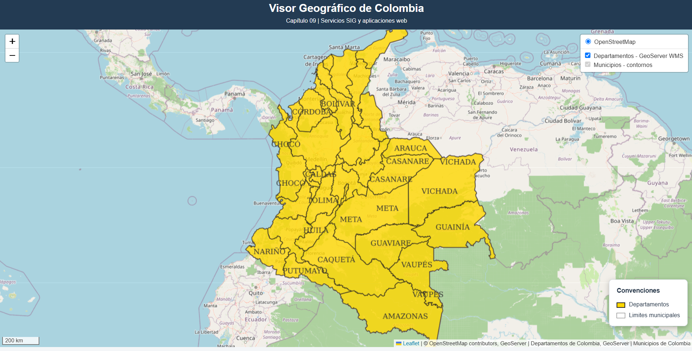
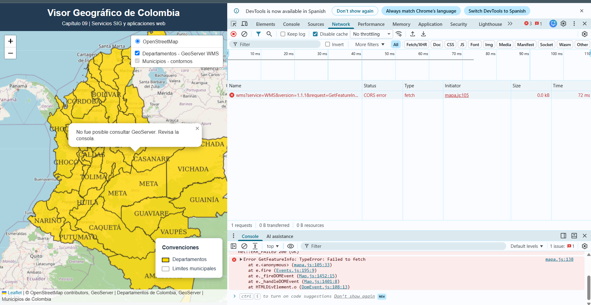
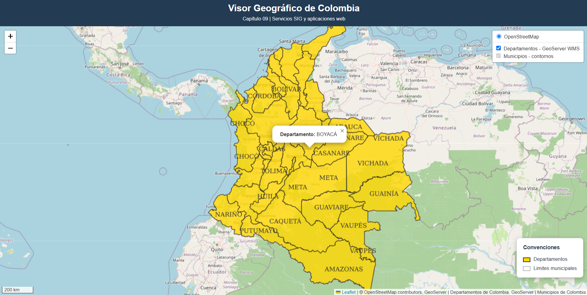
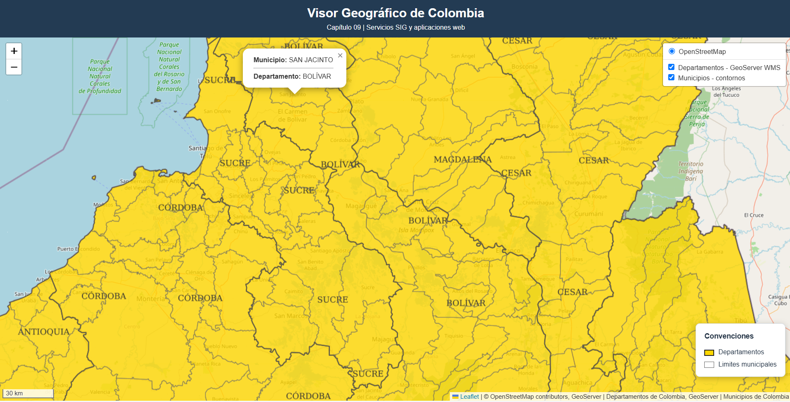

# CAPÍTULO 09 — VISOR CARTOGRÁFICO WEB CON LEAFLET Y GEOSERVER

**Autora:** Jenifer Alexandra Huertas López  
**Formación:** Ingeniería Catastral y Geodesia  
**Actividad:** Servicios SIG y aplicaciones web  
**Fecha de elaboración:** Noviembre de 2026  
**Fecha de entrega:** Noviembre de 2026  

---

## 1. Introducción

Este capítulo presenta el desarrollo de una aplicación web cartográfica para visualizar y consultar información político-administrativa de Colombia.

La solución integra tecnologías de información geográfica, servicios web cartográficos y herramientas de desarrollo web. Se utiliza Leaflet como biblioteca de visualización, GeoServer como servidor de información geográfica y OpenStreetMap como mapa base.

El visor permite consultar departamentos y municipios mediante operaciones WMS GetFeatureInfo.

## 2. Objetivo general

Implementar un visor cartográfico web interactivo que integre información geográfica publicada mediante GeoServer y permita visualizar y consultar atributos de departamentos y municipios de Colombia.

## 3. Objetivos específicos

- Configurar una aplicación cartográfica mediante Leaflet.
- Consumir servicios WMS publicados desde GeoServer.
- Representar departamentos y límites municipales mediante estilos diferenciados.
- Incorporar controles de capas, escala gráfica y convenciones.
- Implementar consultas interactivas con GetFeatureInfo.
- Verificar el funcionamiento de la comunicación entre la aplicación web y GeoServer.

## 4. Arquitectura tecnológica

| Tecnología | Función |
|---|---|
| Docker | Ejecución de los servicios del entorno SIG |
| PostgreSQL/PostGIS | Gestión de información geoespacial |
| GeoServer 2.25.3 | Publicación de servicios cartográficos |
| Leaflet 1.9.4 | Visualización e interacción en el navegador |
| OpenStreetMap | Cartografía base |
| HTML | Estructura de la aplicación |
| CSS | Presentación visual |
| JavaScript | Lógica y controles del mapa |
| Python HTTP Server | Servidor HTTP local para pruebas |

### Servicios locales

| Servicio | Dirección |
|---|---|
| Visor Leaflet | http://localhost:5500 |
| GeoServer | http://localhost:8081/geoserver |
| PostgreSQL/PostGIS | localhost:5433 |

**Nota:** Estas direcciones son locales y no constituyen enlaces a servicios publicados en Internet.

## 5. Información geográfica utilizada

Workspace de GeoServer: `taller`

Capas WMS utilizadas:

- `taller:departamentos`
- `taller:municipios`

Se emplearon estilos cartográficos diferenciados para la representación de los departamentos y los límites municipales.

### Representación

**Departamentos:** polígonos de color dorado y contornos oscuros, acompañados de etiquetas.

**Municipios:** límites de línea gris, sin relleno opaco, visualizados a partir del zoom 8.

Esta configuración permite conservar la lectura de los polígonos departamentales y observar la subdivisión municipal al aumentar la escala de visualización.

## 6. Desarrollo de la aplicación

### 6.1. Inicialización

Se configuró un mapa Leaflet centrado en Colombia, con cartografía base OpenStreetMap.

### 6.2. Consumo de servicios WMS

Se incorporaron las capas de departamentos y municipios publicadas en el workspace `taller` de GeoServer.

### 6.3. Controles cartográficos

La aplicación incorpora:

- Control de activación y desactivación de capas.
- Herramientas de navegación y zoom.
- Escala gráfica en unidades métricas.
- Leyenda con convenciones para departamentos y municipios.

### 6.4. Consultas interactivas

Se implementó una consulta WMS `GetFeatureInfo`, ejecutada mediante clic sobre el mapa.

La consulta recupera los atributos de las entidades geográficas y presenta los resultados mediante una ventana emergente.

En las pruebas se verificaron los siguientes resultados:

- Departamento: **BOYACÁ**.
- Municipio: **SAN JACINTO**.
- Departamento correspondiente: **BOLÍVAR**.

Cuando la capa municipal está activa y el nivel de acercamiento lo permite, la consulta puede identificar tanto el municipio como su departamento.

## 7. Diagnóstico y solución de CORS

Durante las pruebas se identificó un bloqueo de tipo CORS al intentar recuperar los atributos de GeoServer desde el visor web.

La aplicación se ejecutaba desde el origen `http://localhost:5500`, mientras GeoServer utilizaba `http://localhost:8081`.

Aunque ambos servicios estaban disponibles localmente, sus puertos diferentes ocasionaban una restricción de lectura de la respuesta desde el navegador.

Se ajustó la configuración CORS del servicio GeoServer ejecutado en Docker, autorizando los orígenes locales requeridos.

Posteriormente se verificó el funcionamiento de las consultas interactivas de departamentos y municipios.

## 8. Evidencias de implementación

### 8.1. Visualización cartográfica y leyenda



### 8.2. Diagnóstico del bloqueo CORS



### 8.3. Consulta departamental — Boyacá



### 8.4. Consulta municipal — San Jacinto, Bolívar



## 9. Estructura del proyecto

```text
capitulo-09-leaflet/
├── index.html
├── css/
│   └── estilos.css
├── js/
│   └── mapa.js
├── evidencias/
│   ├── 01_visor_leyenda.png
│   ├── 02_error_cors_diagnostico.png
│   ├── 08_consulta_departamento.png
│   └── 09_consulta_municipio_departamento.png
└── README.md
```

## 10. Instrucciones de ejecución

### Requisitos

- Docker Desktop en funcionamiento.
- GeoServer disponible en el puerto 8081.
- Capas WMS publicadas en el workspace `taller`.
- Python instalado.
- Navegador web.

### Ejecución

Abrir PowerShell en la carpeta `capitulo-09-leaflet` y ejecutar:

```powershell
python -m http.server 5500
```

Después, ingresar a:

http://localhost:5500

Para visualizar las capas y realizar consultas, GeoServer debe encontrarse operativo y accesible desde el navegador.

## 11. Resultados

Se comprobó la visualización de la cartografía departamental y municipal mediante servicios WMS.

La aplicación permitió navegar por la información geográfica, administrar las capas y consultar atributos mediante clic.

Las consultas exitosas de Boyacá y San Jacinto, Bolívar, constituyen evidencias del funcionamiento de la operación GetFeatureInfo.

## 12. Conclusiones

La implementación permitió integrar servicios cartográficos GeoServer con una aplicación web basada en Leaflet.

La diferenciación visual de departamentos y municipios facilitó la interpretación de la organización político-administrativa de Colombia a distintas escalas.

La operación GetFeatureInfo amplió la funcionalidad del visor, al permitir consultar información alfanumérica asociada a las entidades espaciales.

La resolución del bloqueo CORS demostró la importancia de configurar correctamente la comunicación entre servicios web ejecutados en puertos diferentes.

El visor constituye una implementación local funcional y documentada, con código y evidencias organizados para su revisión académica.

## 13. Referencias tecnológicas

- Leaflet: https://leafletjs.com/
- GeoServer: https://geoserver.org/
- Documentación GeoServer: https://docs.geoserver.org/
- PostGIS: https://postgis.net/
- OpenStreetMap: https://www.openstreetmap.org/
- Docker: https://docs.docker.com/

---

**Jenifer Alexandra Huertas López**  
**Noviembre de 2026**