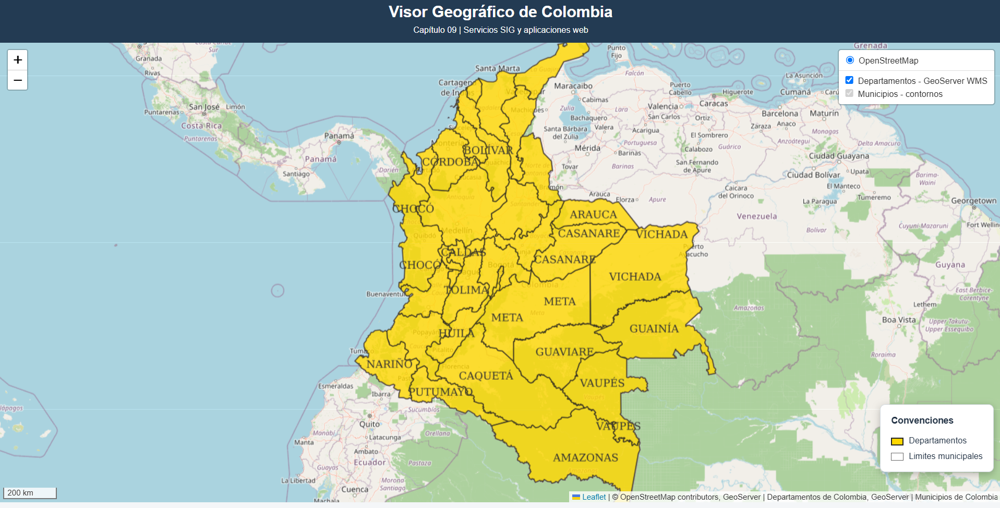
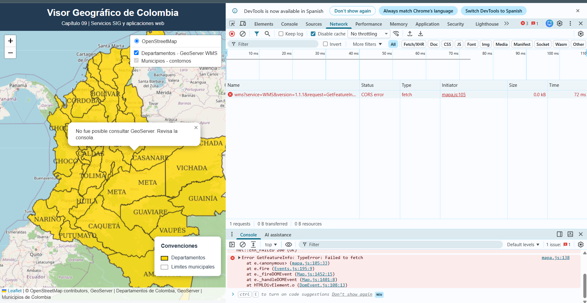
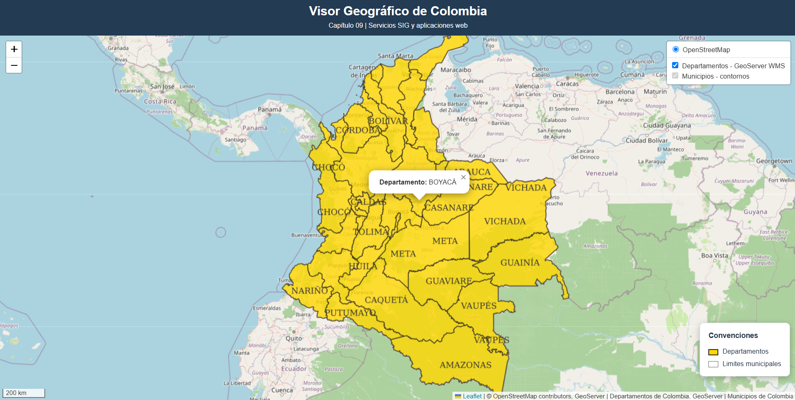
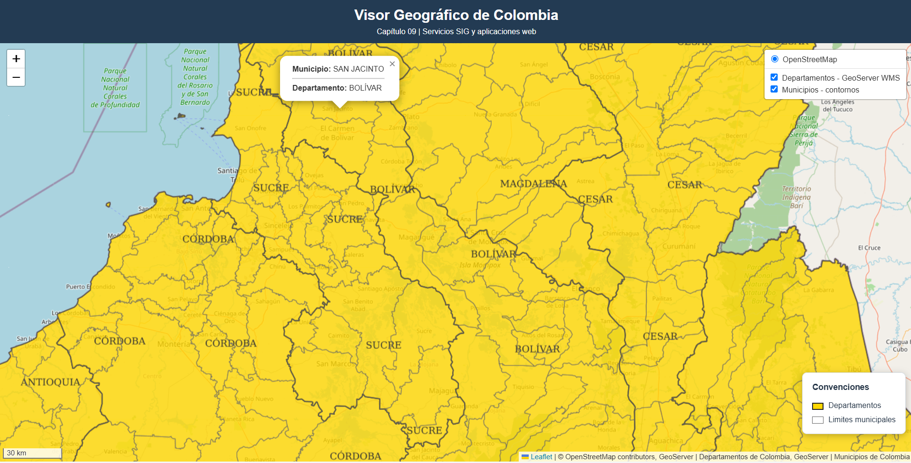

# Capítulo 09 — Evidencias del visor Leaflet

Capturas obtenidas durante las pruebas del visor geográfico de Colombia.

| Evidencia | Descripción |
|---|---|
|  | Visor Leaflet con OpenStreetMap, departamentos WMS y leyenda cartográfica. |
|  | Error CORS detectado al probar GetFeatureInfo (evidencia de diagnóstico, posteriormente resuelto). |
|  | Consulta GetFeatureInfo: departamento BOYACÁ. |
|  | Consulta GetFeatureInfo: municipio SAN JACINTO, departamento BOLÍVAR. |

Estas capturas documentan pruebas realizadas. El ZIP contiene las evidencias y este índice, no el código fuente del visor ni la guía del profesor.

