# Capítulo 8 — Publicación de capas en GeoServer

**Taller:** Servicios SIG y Websites  
**Plataforma:** GeoServer 2.25.3, PostgreSQL 16, PostGIS 3.4, Docker  
**Propósito:** publicar capas administrativas de Colombia y comprobar WMS, WFS y WMTS.

## 1. Objetivo y arquitectura

La práctica integra dos contenedores Docker en la red `servicios_sig_y_websites_default`: `curso_postgis` y `curso_geoserver`. GeoServer utiliza el host interno `postgis` y el puerto `5432`; Windows accede a GeoServer por `localhost:8081` y a PostgreSQL por `localhost:5433`. Estos puertos no son intercambiables.

### Configuración aplicada

| Componente | Valor |
|---|---|
| Workspace | `taller` |
| Namespace URI | `http://www.geoserver.org/taller` |
| Store | `taller_postgis` (PostGIS) |
| Base / esquema | `taller_gis` / `public` |
| Departamento | `taller:departamentos`, 33 entidades, MAGNA-SIRGAS EPSG:4686 |
| Municipio | `taller:municipios`, 1.121 entidades, WGS 84 EPSG:4326 |
| Grupo de capas | `taller:colombia_admin` |
| Estilos | `departamentos_dorado` y `municipios_style` |

Las capas ya habían sido importadas y validadas en el Capítulo 7. En el Capítulo 8 se verificó su publicación desde el almacén PostGIS, manteniendo los sistemas de referencia originales. Para departamentos, se calculó el *Native Bounding Box* aproximado `[-81.7356, -4.2294, -66.8472, 13.3938]`.

## 2. Publicación y simbología

Se creó el workspace `taller` y se configuró el almacén `taller_postgis`. Se publicaron las dos capas, con título, descripción y bounding boxes calculados. Para departamentos se aplicó el SLD `departamentos_dorado` creado en el Capítulo 6 (relleno `#FFD700`, borde oscuro y etiquetas departamentales). Para municipios se creó un nuevo estilo `municipios_style` (relleno verde claro `#C7E9C0`, contornos grises y etiquetas basadas en `mpio_cnmbr`). Este último fue creado para esta práctica, no se certifica como copia literal del archivo original del profesor.

Se creó el grupo `colombia_admin`, se añadieron ambas capas y se comprobó su representación. El relleno dorado departamental tiene predominancia visual y puede ocultar parcialmente el estilo municipal; esto es un ajuste cartográfico pendiente, no un fallo del servicio.

## 3. Comprobaciones OGC

### WMS GetCapabilities

```text
http://localhost:8081/geoserver/taller/wms?service=WMS&version=1.1.1&request=GetCapabilities
```

**Resultado observado:** respuesta XML `WMT_MS_Capabilities` de versión 1.1.1, con las operaciones de WMS disponibles.

### WMS GetMap

```text
http://localhost:8081/geoserver/taller/wms?service=WMS&version=1.1.1&request=GetMap&layers=taller:departamentos&styles=&bbox=-81.7356,-4.2294,-66.8472,13.3938&width=800&height=900&srs=EPSG:4686&format=image/png
```

**Resultado observado:** imagen PNG con los departamentos representados en dorado, límites y etiquetas. La captura está integrada en este informe.

### WFS GetFeature con CQL

Se consultó la capa `taller:departamentos` mediante WFS 2.0.0, con salida GeoJSON y el filtro `dpto_cnmbr='CUNDINAMARCA'`.

```text
http://localhost:8081/geoserver/taller/wfs?service=WFS&version=2.0.0&request=GetFeature&typeNames=taller:departamentos&outputFormat=application/json&CQL_FILTER=dpto_cnmbr%3D%27CUNDINAMARCA%27
```

**Resultado comprobado en PowerShell:** `FeatureCollection`, **1 entidad**, atributo `dpto_cnmbr = CUNDINAMARCA`. El archivo original `wfs_cundinamarca.geojson` fue generado en el repositorio local de la práctica, y debe incluirse al hacer el commit.

### WMTS GetCapabilities

```text
http://localhost:8081/geoserver/gwc/service/wmts?SERVICE=WMTS&REQUEST=GetCapabilities&VERSION=1.0.0
```

**Resultado observado:** documento de capacidades WMTS 1.0.0, con operación `GetTile`. Se comprobó en la práctica la capa `taller:departamentos` y su disponibilidad en GeoWebCache.

### WMTS GetTile

En el primer intento se recibió `TileOutOfRange` porque `TILEROW=10` estaba fuera de los límites `13–16` para la matriz seleccionada. Se corrigieron los índices y la tesela fue devuelta correctamente:

```text
http://localhost:8081/geoserver/gwc/service/wmts?SERVICE=WMTS&VERSION=1.0.0&REQUEST=GetTile&LAYER=taller:departamentos&STYLE=departamentos_dorado&TILEMATRIXSET=EPSG:4326&TILEMATRIX=EPSG:4326:5&TILEROW=14&TILECOL=19&FORMAT=image/png
```

**Resultado observado:** PNG de **256 × 256 píxeles**, con un sector de Arauca y relleno dorado. El archivo `wmts_departamentos.png` se conserva en la carpeta de evidencias del repositorio local.

## 4. GeoWebCache y comparación

Se confirmó en GeoServer que la capa de departamentos tenía activado el caché de teselas, formato `image/png`, y los gridsets `EPSG:4326` y `EPSG:900913`. No se documenta una siembra masiva (*seed*) de los niveles 0 a 10; se verificó una solicitud individual de tesela. WMS `GetMap` genera una imagen de extensión y tamaño solicitado; WMTS `GetTile` obtiene una tesela de matriz, fila y columna predefinidas y reutilizable mediante caché.

La sección **WMTS propio** también se agregó al documento `operaciones-ogc.md`, elaborado en el Capítulo 2, para satisfacer el laboratorio complementario.

## 5. Evidencias gráficas incorporadas

Cada imagen a continuación fue aportada durante la práctica y representa una pantalla real. No se han utilizado imágenes reconstruidas o sintéticas.

### Evidencia 01 — Red Docker compartida entre los contenedores

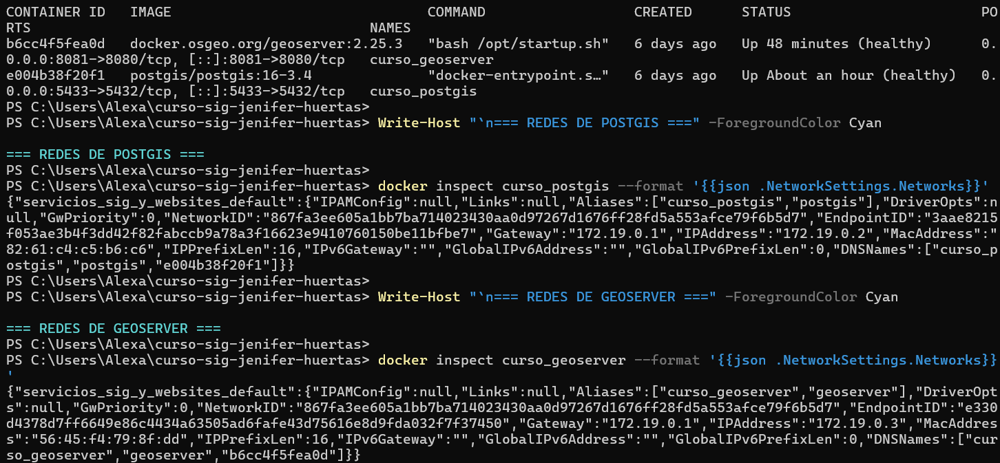

### Evidencia 02 — Configuración del workspace

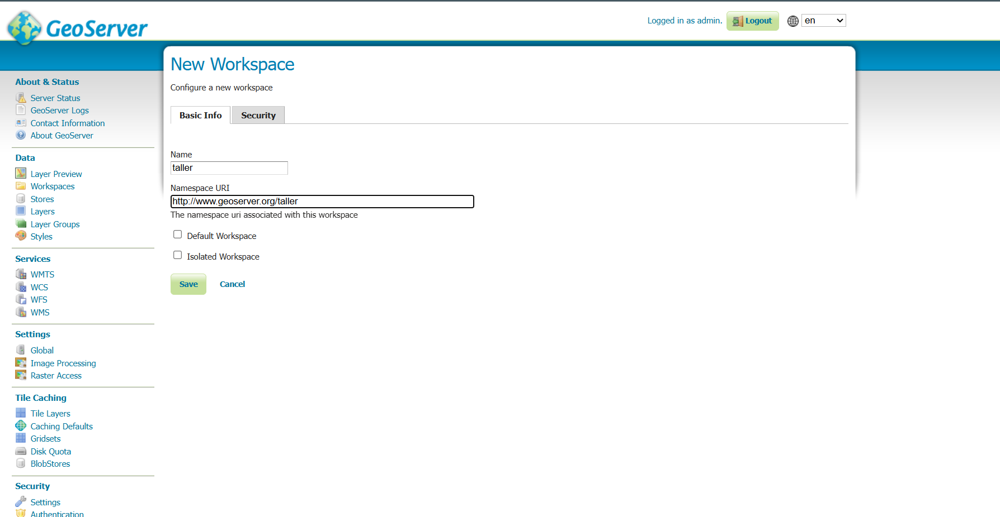

### Evidencia 03 — Workspace taller registrado

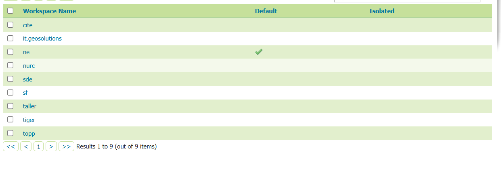

### Evidencia 04 — Configuración del store PostGIS (contraseña oculta)

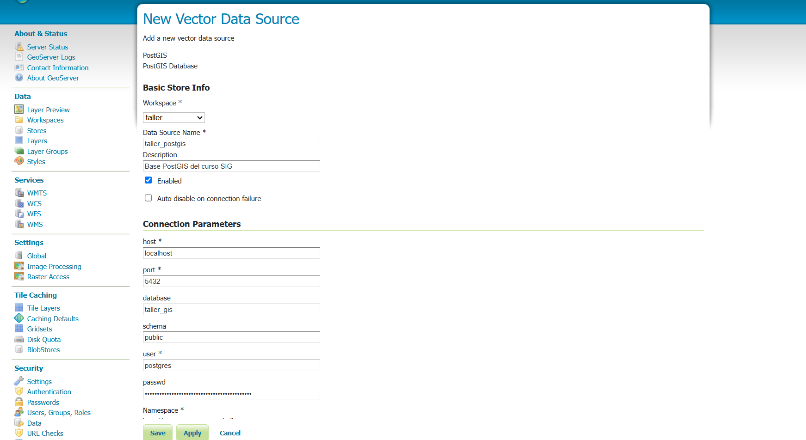

### Evidencia 05 — Store taller_postgis habilitado

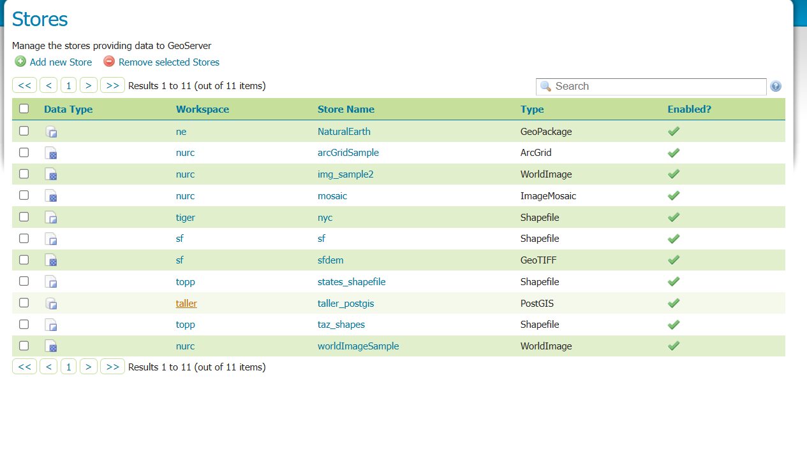

### Evidencia 06 — EPSG:4686 reconocido por GeoServer

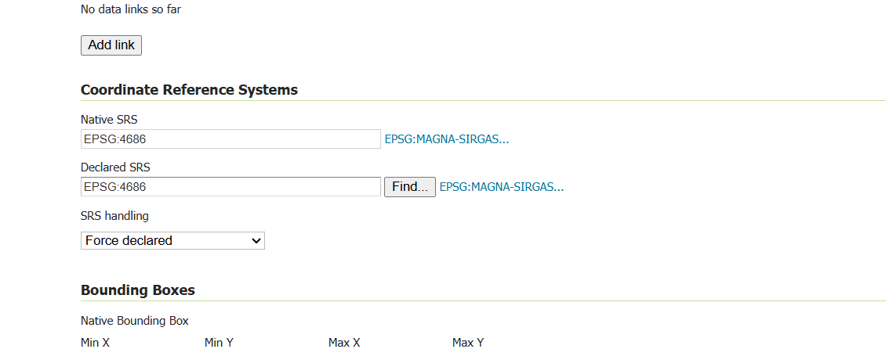

### Evidencia 07 — Extensión de la capa departamental

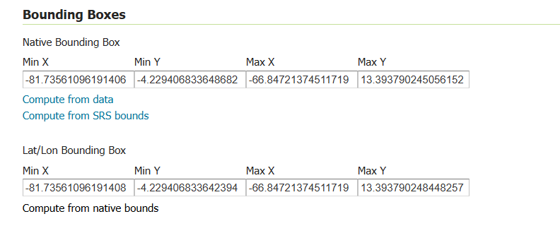

### Evidencia 08 — Capa departamentos publicada

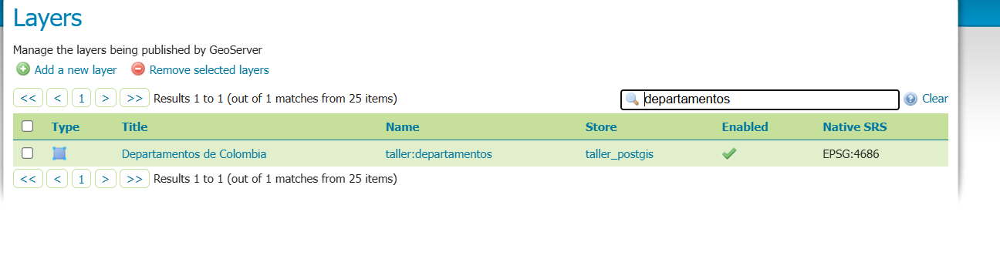

### Evidencia 09 — Capa municipios publicada

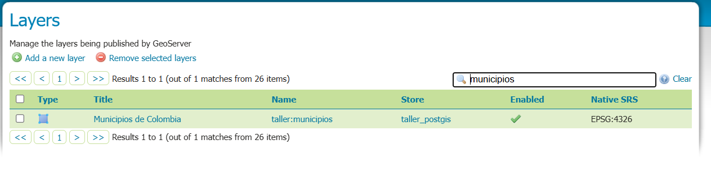

### Evidencia 10 — Vista previa de departamentos con estilo dorado

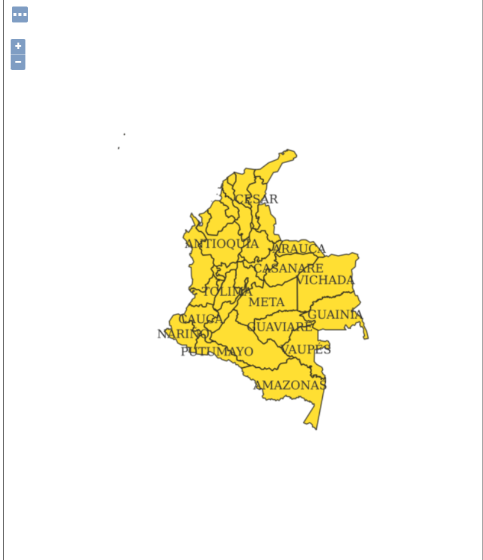

### Evidencia 11 — Vista previa de municipios con estilo verde

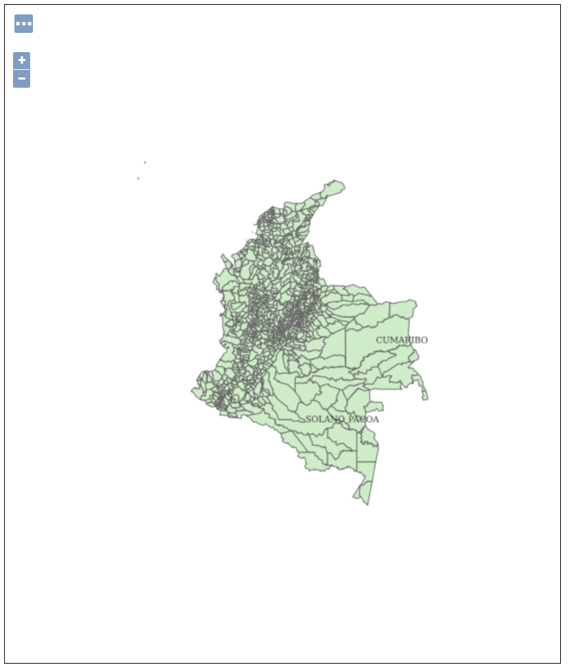

### Evidencia 12 — Configuración del grupo colombia_admin

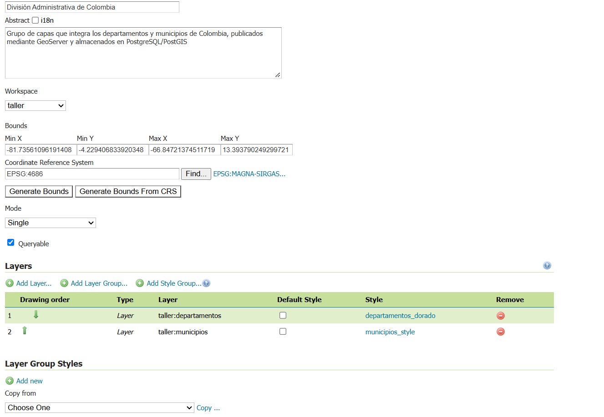

### Evidencia 13 — Vista previa del grupo de capas

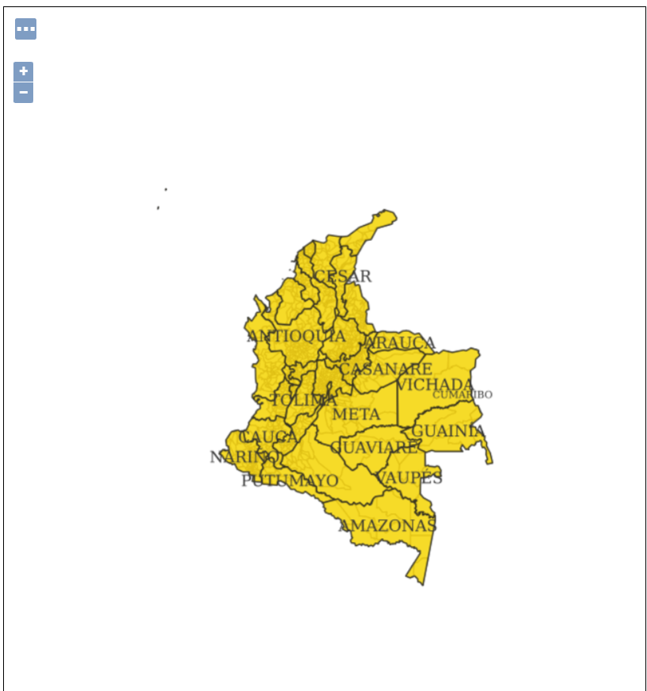

### Evidencia 14 — Respuesta WMS GetCapabilities

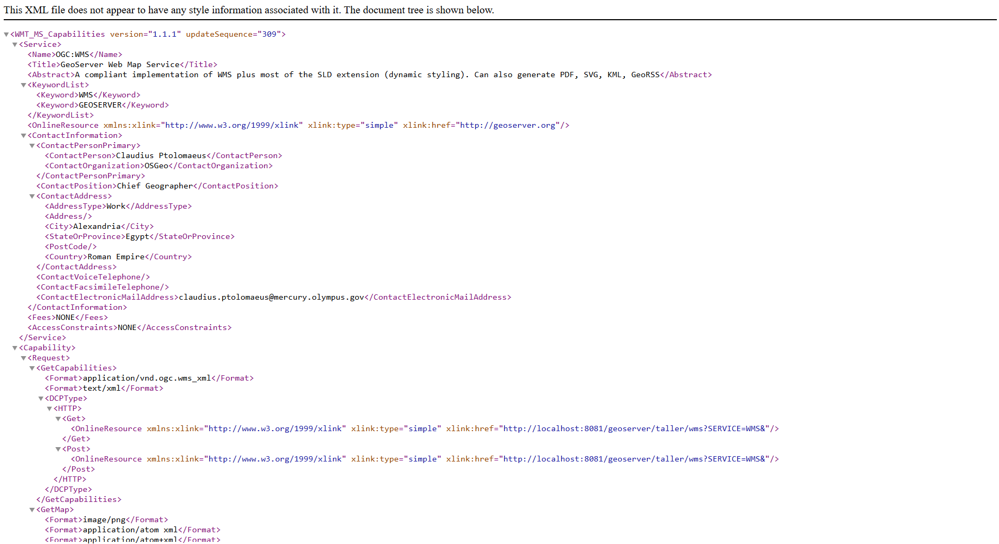

### Evidencia 15 — Mapa PNG generado mediante WMS GetMap

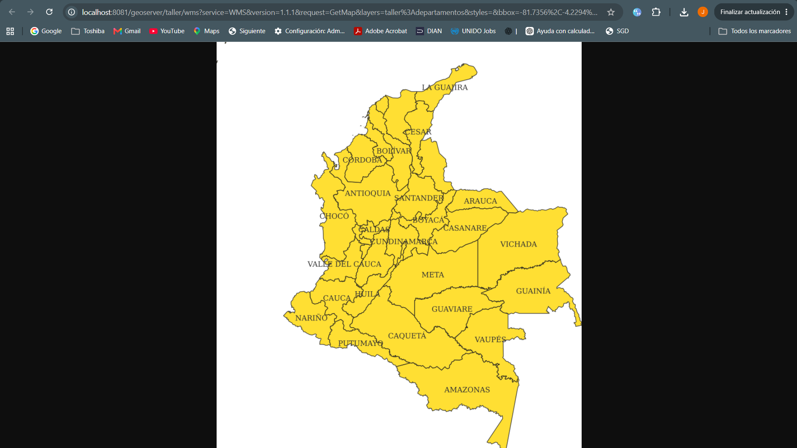

### Evidencia 16 — Configuración de caché GeoWebCache

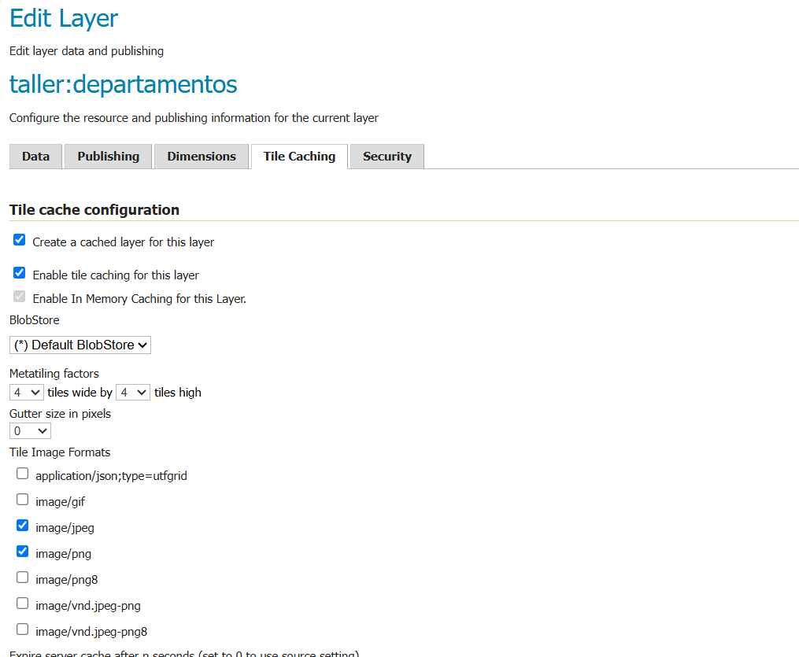

### Evidencia 17 — Gridsets EPSG:4326 y EPSG:900913

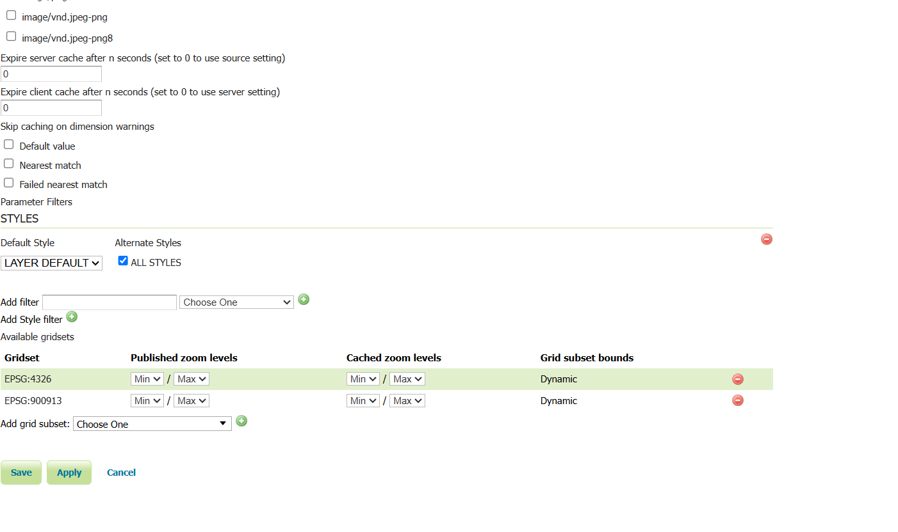

### Evidencia 18 — Respuesta WMTS GetCapabilities

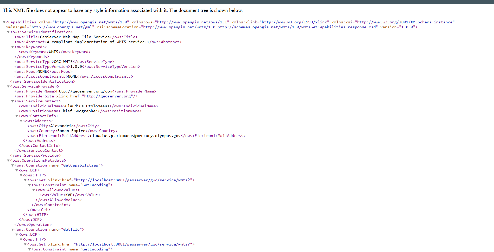

### Evidencia 19 — Tesela PNG GetTile con el departamento de Arauca

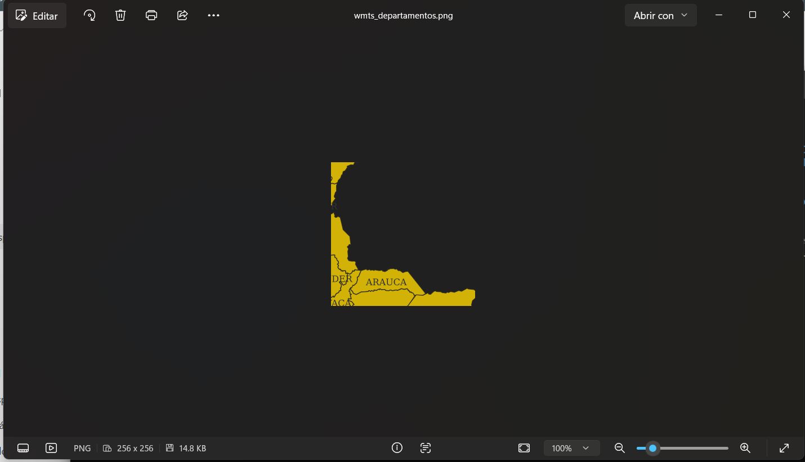

## 6. Estado y pendientes

**Verificado:** conexión de contenedores, workspace, store, publicación de departamentos y municipios, SLD aplicado, visualizaciones individuales, grupo de capas, WMS GetCapabilities/GetMap, WFS GetFeature con CQL, caché habilitado y WMTS GetCapabilities/GetTile.


## 7. Archivos de entrega

- `capitulo-08-publicacion-geoserver.md`: este informe.
- `evidencias/capitulo-08/`: capturas reales de la práctica.
- `evidencias/capitulo-08/wmts_departamentos.png`: tesela original generada en el equipo (copiar del repositorio local).
- `evidencias/capitulo-08/wfs_cundinamarca.geojson`: GeoJSON original generado en el equipo (copiar del repositorio local).
- `operaciones-ogc.md`: apartado “WMTS propio” agregado en el equipo; conservar la versión local sin reemplazarla.

**Nota:** los enlaces a `localhost` únicamente funcionan en el equipo que tiene los servicios Docker activos; GitHub documenta el procedimiento y las evidencias, pero no hospeda esos servicios.
