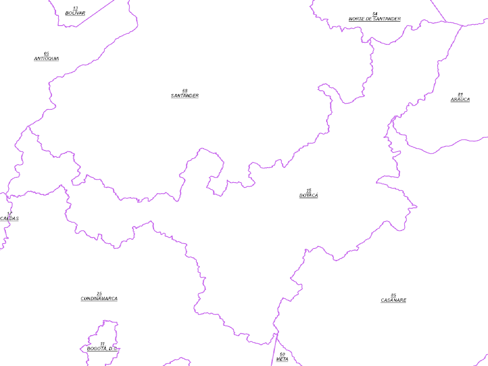
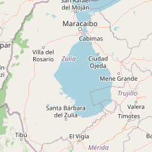

# Capítulo 2 — Exploración y consumo de servicios OGC

**Área de estudio:** Boyacá, Colombia  
**Fuente principal:** DANE, Marco Geoestadístico Nacional 2024  
**Objetivo:** consultar servicios WMS y WFS y explorar la estructura de teselas XYZ.

## 1. WMS — GetCapabilities

Se consultó el servicio WMS del DANE y se descargó un documento XML válido, cuyo elemento principal es `WMS_Capabilities`.

**Capas identificadas:**

| Name | Title | CRS soportados |
|---|---|---|
| 7 | Municipio | CRS:84, EPSG:4326, EPSG:3857, EPSG:102100 |
| 8 | Departamento | CRS:84, EPSG:4326, EPSG:3857, EPSG:102100 |

**Formatos GetMap:** image/bmp, image/jpeg, image/tiff, image/png, image/png8, image/png24, image/png32, image/gif e image/svg+xml.

[Consultar GetCapabilities](https://geoportal.dane.gov.co/mparcgis/services/MGN2024/Serv_CapasMGN_2024/MapServer/WMSServer?service=WMS&request=GetCapabilities)

## 2. WMS — GetMap

Se generó una imagen del área de Boyacá utilizando la capa departamental del DANE.

**Parámetros:**

- Servicio: WMS
- Versión: 1.3.0
- Operación: GetMap
- Capa: 8 (Departamento)
- CRS: EPSG:4326
- BBOX: 4.5,-74.7,7.2,-71.8
- Dimensiones: 1200 × 900 píxeles
- Formato: image/png

[Consultar GetMap](https://geoportal.dane.gov.co/mparcgis/services/MGN2024/Serv_CapasMGN_2024/MapServer/WMSServer?service=WMS&version=1.3.0&request=GetMap&layers=8&styles=&crs=EPSG:4326&bbox=4.5,-74.7,7.2,-71.8&width=1200&height=900&format=image/png)

## 3. WFS — GetFeature con filtro espacial

Se consultó la capa Municipio del WFS del DANE, utilizando un filtro BBOX y solicitando la respuesta en formato GeoJSON.

**Parámetros:**

- Servicio: WFS
- Versión: 2.0.0
- Operación: GetFeature
- Tipo de entidad: Serv_CapasMGN_2024:Municipio
- BBOX: 4.5,-74.7,7.2,-71.8,EPSG:4326
- Formato: GEOJSON
- CRS: EPSG:4326
- Límite solicitado: 2000

**Resultado verificado: 347 elementos GeoJSON.**

El rectángulo consultado incluye sectores de departamentos vecinos, por lo que este valor no corresponde exclusivamente a los municipios de Boyacá.

La primera consulta, con el orden de ejes inverso, devolvió cero elementos. La corrección del BBOX permitió obtener los 347 registros.

## 4. Teselas XYZ

Se descargó una tesela cartográfica de OpenStreetMap para explorar el funcionamiento de los niveles de zoom y las coordenadas de teselas.

| Parámetro | Valor |
|---|---|
| Esquema | XYZ |
| Zoom (z) | 7 |
| Columna (x) | 38 |
| Fila (y) | 60 |
| Formato | PNG |
| Dimensiones | 256 × 256 píxeles |

**URL:** https://tile.openstreetmap.org/7/38/60.png

Las teselas XYZ utilizan la estructura `z/x/y`, mientras que el estándar WMTS identifica las teselas mediante parámetros como TileMatrix, TileRow y TileCol.

## Conclusiones

El ejercicio permitió comprobar las diferencias entre los servicios WMS, WFS y las teselas XYZ. WMS entrega imágenes cartográficas; WFS permite obtener geometrías y atributos para análisis espacial; y las teselas XYZ proporcionan imágenes organizadas por niveles de zoom.

Se comprobó también la importancia de interpretar correctamente el orden de los ejes de coordenadas, especialmente al utilizar EPSG:4326 en distintas versiones de servicios OGC.

**Repositorio:** https://github.com/alexandraicg-stack/curso-sig-jenifer-huertas
